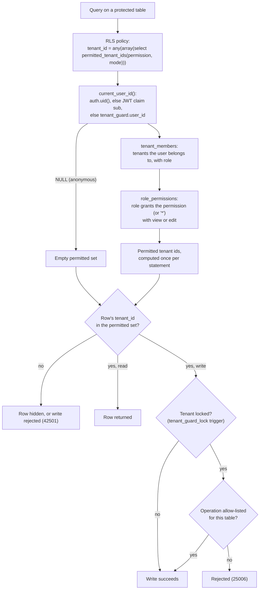

# pg-tenant-guard

[](https://github.com/shivamlaur022/pg-tenant-guard/actions/workflows/ci.yml)
[](LICENSE)

Tenant isolation and a database-enforced read-only "tenant lock" for
multi-tenant SaaS on PostgreSQL and Supabase. Plain SQL in one file. There is
no extension to build and no service to run.

- **Isolation.** `select tenant_guard.protect_table('public.projects')` adds
  row-level security policies so users only see and change rows of tenants
  they belong to, with `view` or `edit` access depending on their role.
- **Tenant lock.** `select tenant_guard.lock_tenant(id, 'trial ended')` makes a
  tenant read-only. Writes are rejected by a trigger, so they are rejected for
  every role and every code path, while reads keep working. Per-table
  allow-lists keep things like payments and exports writable.

Tested on PostgreSQL 16 and 17 and against the `supabase/postgres` image.

## Why

In a shared-schema multi-tenant app every table has a `tenant_id`, and every
query has to filter on it. Miss the filter once and one customer sees another
customer's data. Row-level security moves the filter into the database, but
writing policies for every table by hand is repetitive and easy to get subtly
wrong:

- a policy on the membership table that queries the membership table recurses
  forever;
- a policy that calls a function per row turns every query into a sequential
  scan;
- an UPDATE policy without `WITH CHECK` lets a user move a row into a tenant
  they don't belong to;
- a `SECURITY DEFINER` helper without a pinned `search_path` can be hijacked.

The second recurring need is billing: when a customer stops paying, their data
should become read-only. That has to hold for background jobs and for the
endpoint someone forgot about, not just the main UI, and the customer still
needs to be able to pay and export.

pg-tenant-guard packages both patterns as about 900 lines of commented SQL that
you can read in one sitting.

## Quickstart

Install (one transaction, safe to re-run):

```sh
curl -sSLO https://raw.githubusercontent.com/shivamlaur022/pg-tenant-guard/v0.1.0/dist/pg-tenant-guard.sql
psql "$DATABASE_URL" -v ON_ERROR_STOP=1 -f pg-tenant-guard.sql
```

On Supabase, paste the file into the SQL editor or save it as a migration in
`supabase/migrations/`.

Protect a table:

```sql
create table public.projects (
  id        bigint generated always as identity primary key,
  tenant_id uuid not null references tenant_guard.tenants (id),
  title     text not null
);
create index on public.projects (tenant_id);

select tenant_guard.protect_table('public.projects');
```

That's it. For a signed-in user:

```sql
select tenant_guard.create_tenant('Acme');                -- caller becomes owner
insert into projects (tenant_id, title) values ('<acme id>', 'Roadmap');   -- ok
insert into projects (tenant_id, title) values ('<other id>', 'x');
-- ERROR: new row violates row-level security policy for table "projects"
select * from projects;                                   -- only rows of the user's tenants
```

Lock a tenant from your billing backend:

```sql
select tenant_guard.lock_tenant('<acme id>', 'subscription expired');
update projects set title = 'v2' where tenant_id = '<acme id>';
-- ERROR: tenant ... is locked: UPDATE on public.projects is not allowed  (SQLSTATE 25006)
select tenant_guard.unlock_tenant('<acme id>');
```

## Setup

### Supabase

- The installer grants the client-facing functions and tables to `anon` and
  `authenticated` automatically. The current user comes from `auth.uid()`.
- Tables you create in `public` are already granted to the API roles by
  Supabase, so `protect_table()` is the only extra step.
- To call `create_tenant`, `has_permission` and friends from `supabase-js`,
  either add `tenant_guard` to **Settings → API → Exposed schemas** and use
  `supabase.schema('tenant_guard').rpc(...)`, or wrap them in your own
  functions in `public`.
- Lock administration is not granted to anyone. To call it from an Edge
  Function using the service role:

  ```sql
  grant usage on schema tenant_guard to service_role;
  grant execute on function tenant_guard.lock_tenant(uuid, text),
                            tenant_guard.unlock_tenant(uuid) to service_role;
  ```

### Plain PostgreSQL

Create a role for your API, grant it access, and set the user per transaction:

```sql
create role app_user nologin;
select tenant_guard.grant_to('app_user');
grant select, insert, update, delete on public.projects to app_user;
```

```sql
-- in your backend, for each request
begin;
set local role app_user;
set local tenant_guard.user_id = '6f1c2b9e-...';
select * from projects;
commit;
```

If you use PostgREST, you don't need `tenant_guard.user_id`: the `sub` claim
from `request.jwt.claims` is picked up automatically.

## How the access check works



Reads need `view` access and writes need `edit`. The lock trigger runs for
every role, including the table owner and roles with `BYPASSRLS`, which skip
the RLS steps.

## Permissions

Each member has one role per tenant. Roles are global, and each role is
granted a set of permissions with an access mode. `edit` implies `view`.

| role | permission | access |
|---|---|---|
| `owner` | `*` | edit |
| `owner` | `tenant_guard.members` | edit |
| `owner` | `tenant_guard.tenant` | edit |
| `editor` | `*` | edit |
| `viewer` | `*` | view |

A permission is just a name. `protect_table('public.projects')` uses the table
name (`projects`) by default; pass another name to group tables:
`protect_table('public.invoices', 'billing')`.

`*` matches every permission **except** the built-in `tenant_guard.*` ones.
Granting a role blanket edit access to tenant data therefore does not let it
manage members or promote itself to owner. Built-in permissions must always be
granted explicitly.

Customising is plain SQL:

```sql
-- viewers may also edit comments
insert into tenant_guard.role_permissions values ('viewer', 'comments', 'edit');

-- a role that only handles billing
insert into tenant_guard.roles (name, description) values ('billing', 'Invoices only');
insert into tenant_guard.role_permissions values ('billing', 'billing', 'edit');
```

## Tenant lock

```sql
select tenant_guard.protect_table('public.payments',
  allow_when_locked => array['INSERT', 'UPDATE']);   -- payments keep working

select tenant_guard.lock_tenant('<tenant id>', 'payment overdue');
select tenant_guard.unlock_tenant('<tenant id>');    -- true if it was locked
```

- Rejected writes raise SQLSTATE `25006` (`read_only_sql_transaction`) with
  the reason in `DETAIL`. Map that code to a "subscription required" response
  in your API layer.
- For UPDATE both the old and new `tenant_id` are checked, so a row can't be
  edited inside a locked tenant or moved into one.
- The lock state lives in `tenant_guard.tenant_locks`. Clients have no access
  to it, and no tenant-level permission can remove a lock.
- `is_locked(tenant_id)` lets your UI show a banner. It answers only for
  tenants the caller belongs to.
- For tables with your own policies, use `attach_lock_trigger(table, allow)` by
  itself.

## API reference

All objects live in the `tenant_guard` schema. "Clients" means the roles
passed to `grant_to()` (on Supabase: `anon`, `authenticated`).

### Functions for policies and the application

| Function | Returns | Clients | Description |
|---|---|---|---|
| `current_user_id()` | `uuid` | yes | Current user: `auth.uid()` if it exists, else `request.jwt.claim.sub` / `request.jwt.claims->>'sub'`, else the `tenant_guard.user_id` setting. NULL when anonymous. |
| `is_member(tenant_id uuid)` | `boolean` | yes | Current user belongs to the tenant. |
| `member_role(tenant_id uuid)` | `text` | yes | Current user's role in the tenant, or NULL. |
| `my_tenant_ids()` | `setof uuid` | yes | Tenants the current user belongs to. |
| `has_permission(tenant_id uuid, permission text, mode access_mode = 'view')` | `boolean` | yes | Current user's role grants `permission` with at least `mode`. |
| `permitted_tenant_ids(permission text, mode access_mode = 'view')` | `setof uuid` | yes | Tenants where the current user has `permission` with at least `mode`. Use this in policies. |
| `create_tenant(name text)` | `uuid` | yes | Creates a tenant with the caller as owner. Requires a signed-in user. |
| `is_locked(tenant_id uuid)` | `boolean` | yes | Tenant is locked; NULL for tenants the caller isn't in. |

### Administration (not granted to clients)

| Function | Returns | Description |
|---|---|---|
| `protect_table(tbl regclass, permission text = <table name>, allow_when_locked text[] = '{}')` | `void` | Enables RLS, creates the four `tenant_guard_*` policies and attaches the lock trigger. Idempotent. Warns if no index starts with `tenant_id`. |
| `unprotect_table(tbl regclass)` | `void` | Drops the policies and the lock trigger. RLS stays on, so the table becomes deny-all. |
| `unprotected_tables()` | `setof regclass` | Tables with a `tenant_id` column that lack RLS, a policy or the lock trigger. Useful as a CI check. |
| `lock_tenant(tenant_id uuid, reason text = null)` | `void` | Locks a tenant (updates the reason if already locked). |
| `unlock_tenant(tenant_id uuid)` | `boolean` | Unlocks; true if it was locked. |
| `attach_lock_trigger(tbl regclass, allow_when_locked text[] = '{}')` | `void` | Attaches only the lock trigger. |
| `detach_lock_trigger(tbl regclass)` | `void` | Removes the lock trigger. |
| `grant_to(role_name name)` | `void` | Grants a role the client-facing privileges. |
| `version()` | `text` | Installed version. |

### Tables

| Table | Purpose | Clients |
|---|---|---|
| `tenants (id, name, created_at)` | One row per tenant. | Read own tenants; rename with `tenant_guard.tenant` edit. |
| `tenant_members (tenant_id, user_id, role, created_at)` | Memberships. | Read own tenants' members; change with `tenant_guard.members` edit. |
| `roles (name, description)` | Role names. | Read. |
| `role_permissions (role, permission, access)` | What each role may do. | Read. |
| `tenant_locks (tenant_id, reason, locked_at)` | Locked tenants. | None. |

Policies created by `protect_table`: `tenant_guard_select` (view),
`tenant_guard_insert` (edit, `WITH CHECK`), `tenant_guard_update` (edit,
`USING` and `WITH CHECK`), `tenant_guard_delete` (edit). The trigger is
named `tenant_guard_lock`.

## Security notes

- **SECURITY DEFINER helpers.** The membership and permission helpers run as
  the role that installed the kit. That is what lets the policy on
  `tenant_members` look up memberships without recursing into itself, and it
  keeps clients from reading the membership table directly. Each definer
  function pins `search_path = ''`, refers to every object by schema-qualified
  name, and builds no dynamic SQL from its arguments. Install as the role that
  owns your schema (`postgres` on Supabase), never as a role clients can use.
- **Nothing is granted to `PUBLIC`.** Execute on all functions is revoked, and
  `grant_to()` hands back an explicit allow-list. The test suite checks the
  exact set of client-executable functions, that every function pins its
  `search_path`, and that every table has RLS enabled.
- **RLS does not apply to table owners or `BYPASSRLS` roles.** If your backend
  connects as the role that owns your tables, the policies do nothing. Use a
  separate, non-owner role for requests, or
  `alter table ... force row level security`. The tenant lock is a trigger and
  applies regardless.
- **Views bypass RLS** unless created with `security_invoker = true`
  (PostgreSQL 15+). Expose protected tables through invoker views only.
- **`tenant_guard.user_id` is a session setting.** Any session can set it, so it
  is only safe when end users can't run arbitrary SQL, for example when they go
  through your backend or PostgREST. This is the same trust model as
  PostgREST's `request.jwt.claims`. When `auth.uid()` exists it is treated as
  authoritative, and the other settings are not consulted.
- **Malformed identities fail closed.** A non-uuid user id raises `22P02`
  rather than being treated as anonymous.
- **Changing identity resolution.** Replace `tenant_guard.current_user_id()`
  with `create or replace function`. Every helper goes through it.

## Performance

- **Index `tenant_id`.** Every query on a protected table filters on it.
  `protect_table()` warns when no index starts with `tenant_id`. Composite
  indexes that lead with it (`(tenant_id, created_at)`) serve both the policy
  and your queries.
- **Policies compute the permitted set once per statement.** They use
  `tenant_id = any (array(select tenant_guard.permitted_tenant_ids(...)))`.
  The uncorrelated `array(select ...)` becomes an InitPlan that runs once, and
  `= any(array)` can use the `tenant_id` index. The shorter
  `tenant_id in (select ...)` also runs once, but becomes a hashed SubPlan
  filter that cannot use an index. On 200k rows across 1,000 tenants that was
  35 ms (sequential scan) vs 0.7 ms (bitmap index scan). A test enforces the
  index-friendly plan.
- **In your own policies, wrap row-independent calls in `(select ...)`.**
  `using (owner_id = (select auth.uid()))` evaluates `auth.uid()` once. Without
  the `select` it is evaluated per row. Calls that depend on the row, such as
  `has_permission(tenant_id, ...)`, can't be hoisted this way. Prefer the
  set-returning `permitted_tenant_ids()` pattern above for those.
- **Membership lookups are index-only scans** via
  `tenant_members (user_id) include (tenant_id, role)`.
- **The lock trigger costs one primary-key lookup per written row.** Rows of
  allow-listed operations skip it.

## Limitations

- Shared-schema tenancy only. Tables need a column named exactly `tenant_id`
  of type `uuid`, and user ids must be uuids.
- Roles and their permissions are global. Per-tenant custom roles are not
  supported.
- Nothing stops an owner from removing or demoting the last owner of a tenant.
- The lock is checked per row and doesn't cover `TRUNCATE` (don't grant it to
  client roles). A write in a transaction that started before `lock_tenant()`
  committed can still commit.
- `tenants` and `tenant_members` are not subject to the lock.
- The lock trigger is a `BEFORE` trigger named `tenant_guard_lock`. A
  `BEFORE` trigger that sorts after it by name and changes `tenant_id` is not
  re-checked.
- Partitioned tables: policies on the parent don't apply when a partition is
  queried directly. Don't grant client roles access to partitions. This is
  untested.
- Pre-1.0: there are no upgrade scripts between versions yet. Re-running the
  same version's installer is safe.
- CI covers PostgreSQL 16 and 17. Older versions (13+) are likely to work but
  are untested.

## Development

Requires Docker and `make`.

```sh
make test                 # build dist, run the pgTAP suite on PostgreSQL 17
make test PG_VERSION=16
make test-supabase        # install into supabase/postgres and run the smoke test
make dist                 # rebuild dist/pg-tenant-guard.sql after editing sql/
```

```
sql/            source, installed in file order
dist/           generated single-file installer (committed)
test/sql/       pgTAP tests, one transaction per file
test/supabase/  smoke test for the supabase/postgres image
scripts/        build and test runners
```

See [CONTRIBUTING.md](CONTRIBUTING.md).

## License

[MIT](LICENSE)
